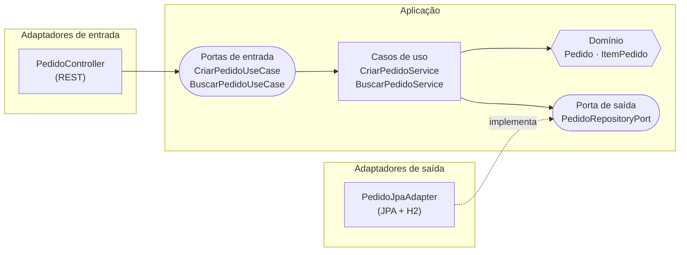

# Pedidos Hexagonal


Projeto do curso **[Arquitetura Hexagonal na Prática com Java e Spring Boot](LINK_DO_CURSO_NA_UDEMY)**.

Uma API de pedidos construída do zero com **Ports & Adapters**: as regras de negócio ficam no centro, em Java puro, e a tecnologia (REST, JPA, banco) fica na borda, plugada por adaptadores.

> **O domínio no centro. A tecnologia na borda.**

---

## A arquitetura



**A regra de ouro:** as dependências sempre apontam para dentro. O domínio não conhece Spring, JPA nem HTTP. Quando precisa de algo de fora, ele declara uma **porta** (uma interface), e um **adaptador** implementa.

---

## Estrutura de pacotes

```
br.com.loja.pedidos
├── domain/                 ← Java puro: regras de negócio
│   ├── model/              ← Pedido, ItemPedido, StatusPedido
│   └── exception/          ← exceções de negócio
├── application/
│   ├── port/in/            ← portas de entrada (casos de uso)
│   ├── port/out/           ← portas de saída (o que o domínio precisa de fora)
│   └── service/            ← implementação dos casos de uso
├── adapter/
│   ├── in/web/             ← controller REST, DTOs e tratamento de erros
│   └── out/persistence/    ← entidade JPA, mapper e adaptador do repositório
└── config/                 ← liga casos de uso e adaptadores (único lugar com Spring + application)
```

---

## Tecnologias

- **Java 20+**
- **Spring Boot 3.5** (Web e Data JPA)
- **H2**, banco em memória: não precisa instalar banco nem Docker
- **JUnit 5**, **Mockito** e **AssertJ** nos testes
- **ArchUnit** para garantir a arquitetura por teste

---

## Como rodar

**Pré-requisitos:** Java 20 ou mais recente. O Maven já vem embutido na IntelliJ, mas também funciona pela linha de comando.

```bash
git clone LINK_DO_REPOSITORIO
cd pedidos-hexagonal
mvn spring-boot:run
```

Ou abra o projeto na sua IDE e rode a classe `PedidosApplication`.

A API sobe em `http://localhost:8080`.

---

## Testando a API

**Criar um pedido**

```bash
curl -i -X POST http://localhost:8080/pedidos \
  -H "Content-Type: application/json" \
  -d '{
    "cliente": "Maria",
    "itens": [
      { "produto": "Teclado", "quantidade": 2, "precoUnitario": 150.00 },
      { "produto": "Mouse",   "quantidade": 1, "precoUnitario": 80.00 }
    ]
  }'
```

Resposta `201 Created`, com o header `Location` apontando para o pedido criado:

```json
{
  "id": "3f6c1e2a-...",
  "cliente": "Maria",
  "status": "CRIADO",
  "itens": [
    { "produto": "Teclado", "quantidade": 2, "precoUnitario": 150.00, "subtotal": 300.00 },
    { "produto": "Mouse",   "quantidade": 1, "precoUnitario": 80.00,  "subtotal": 80.00 }
  ],
  "total": 380.00,
  "criadoEm": "2026-10-28T20:00:00Z"
}
```

**Buscar um pedido**

```bash
curl http://localhost:8080/pedidos/{id}
```

**Erros de negócio**

| Situação | Status |
| --- | --- |
| Pedido sem cliente, sem itens, ou item com quantidade/preço inválido | `400 Bad Request` |
| Pedido não encontrado | `404 Not Found` |

**Console do banco:** `http://localhost:8080/h2-console`. Use a JDBC URL `jdbc:h2:mem:pedidos`, usuário `sa` e senha em branco.

---

## Testes

```bash
mvn test
```

| Tipo | O que testa | Sobe o Spring? |
| --- | --- | --- |
| Unidade (`PedidoTest`) | Regras do domínio | Não. Roda em milissegundos |
| Unidade (`*ServiceTest`) | Casos de uso, com mock da porta | Não |
| Integração (`PedidoJpaAdapterTest`) | Mapeamento JPA e o adaptador | Só a parte de JPA (`@DataJpaTest`) |
| Arquitetura (`ArquiteturaTest`) | Domínio e application sem depender de Spring/JPA | Não |

---

## Desafio

O domínio já sabe cancelar um pedido (`Pedido.cancelar()`), mas a API ainda não expõe essa operação. Tente fazer sozinho:

1. Criar a porta de entrada `CancelarPedidoUseCase` e o `CancelarPedidoService`.
2. Registrar o bean na `UseCaseConfig`.
3. Expor `PATCH /pedidos/{id}/cancelamento` no `PedidoController`.
4. Escrever o teste unitário do service usando um mock da porta.

---

## Sobre o curso

Este repositório acompanha o curso **[Arquitetura Hexagonal na Prática com Java e Spring Boot](LINK_DO_CURSO_NA_UDEMY)**, onde o projeto é construído do zero, aula por aula.

Dúvidas? Use a área de **Perguntas e Respostas** do curso na Udemy.

Feito por **[Flaviano Inácio](https://github.com/FlavianoInacio)**.
